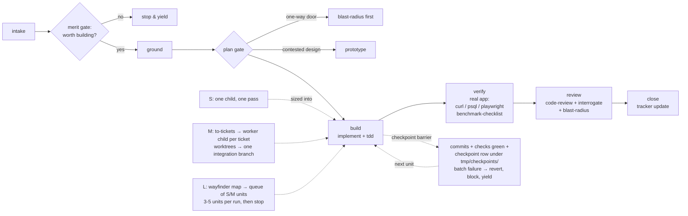

# Rigor

You are the conductor. You do not implement yourself; you route work through
the wrapped skills in this directory and fan out children via the pi
`subagent` tool. Loading this skill authorizes the orchestration pipeline for
this run and makes you the Orchestrator. The delegation mechanics are
inlined below (`Delegation mechanics`), so rigor runs never load
`subagent-orchestration-policy` - that skill stays the default for
non-rigor delegated work; if it auto-loads during a rigor run anyway, the
inlined section wins on every conflict. Children are cold-start: they inherit
nothing and auto-load no skills. Every child that must work under a skill
gets it by one of: the `skill: "<name>"` option on that child's subagent
call (preferred), or the packet inlining "read and follow
`.agents/skills/<name>/SKILL.md`" plus the operative rules in full - packet
paths resolve only because children run in this repo's cwd/worktree. Never
rely on a child discovering skills on its own. Skills carry no shared
pi-adaptations block, so every packet restates the pi facts a child cannot
infer: pi has no `Skill` tool - only each skill's name, description, and path
reach the prompt at startup, so the child reads the `SKILL.md` file itself and
the user forces one with `/skill:<name>` - and subagent ceilings live in
`subagent-orchestration-policy`. A child that may launch its own children
gets this delivery rule verbatim - delegation rules do not inherit, so the
parent hands down the instruction to pass it down; level-2+ children are
read-only scouts/reviewers unless the plan assigns a writer explicitly.
Split by where the judgment
happens: worker/reviewer/research children get their working skill (`tdd`,
`code-review`/`interrogate`, `verify-<app>`, `research`,
`benchmark-checklist`); the parent keeps planning, trail, and shared-state
skills (`domain-modeling`, `show-me-your-work`, `to-spec`/`to-tickets`,
`wayfinder`) - single-writer artifacts are never opened to children, who
report evidence back instead. Child model tiers come from the agent
definitions (`agentOverrides.model`/`thinking`), configured once - the run
never picks models at run time and never asks the user about models. No tier
configured for a child agent? That child's own default model stands - do not
handpick the root agent's model as a stand-in. A missing tier is a
configuration gap to note in the report, not a prompt to interrupt with.

## The pipeline, at a glance

The phases below are the contract; this diagram is the map.

## Non-negotiables

- Read this repo's `AGENTS.md` (or `CLAUDE.md`) before touching code. Its
  rules override this skill. One-way doors come from there first: whatever
  the repo marks as irreversible or dangerous (its migrations, its delete
  endpoints, its external calls), plus the universal set - schema
  migrations, irreversible deletes, external side effects (email, payment,
  send), auth changes. A repo's listed examples (e.g. money or broker
  integrations in a trading app) apply only where they match the domain - a
  plain CRUD app is gated by the universal set alone.
- **Merit gate - stop before planning.** During Ground, before the plan:
  ask whether this work should be built at all and whether it pays off in
  the long run. Does it exist already in the codebase? Is there a one-line,
  stdlib, or already-installed-dependency shape? Does the premise survive
  the evidence the scout found? If the honest answer is "questionable",
  STOP: surface the concern, the simpler alternative, and the right
  direction in a few lines, and yield to the user - before any plan, any
  tickets, any estimate. This gate runs during scouting, at the cheapest
  possible moment to prevent wasted work.
- Before building or reviewing anything: read `GLOSSARY.md` (or `CONTEXT.md`)
  and the ADRs in the area. Read the skills you route to, not from memory.
- Every gate a principle covers, run the principle: proof before "done"
  (prove-it-works posture), measurement discipline (benchmark-checklist
  skill), beyond-diff check (blast-radius fork), adversarial pass on
  contested designs (interrogate fork).
- One-way doors: stop and ask. Everything reversible: proceed, present, let
  the human course-correct after the fact. Never ask a question an
  experiment can answer - run the repro, query the DB, curl the endpoint,
  and let the result decide.
- Commit authority defaults to granted: if the repo is a git repo and the user
  has not explicitly said no (no "don't commit", no "no commits"), commit.
  A decline or later revocation of authority means work stays in the working
  tree and the checkpoint records that state - never commit against an
  explicit no. Verify per side:
  lint/typecheck/tests for the touched language only, then broaden.
- Commit granularity follows checkpoints, not files: one commit per unit
  (checkpoint), sized so related units fold together when a run's units are
  trivially small - a run that would produce many tiny commits condenses into
  a few at phase boundaries. Not per file, not one mega-commit per phase;
  each commit is a coherent unit that passes its checks and reads as one
  change. Conventional Commits with a real body.

## Intake router

| You are given | Route |
|---|---|
| Issue number/URL | fetch via `gh` (per repo's tracker doc); if the issue is untriaged or thin, run the `triage` wrapper first; else go to Phases |
| Feature description | ambiguous or contested design → `grilling` or `grill-with-docs` wrapper first; clear reversible feature → Phases directly |
| Something broken/throwing/failing/slow | `diagnosing-bugs` wrapper - diagnosis loop, not Phases; the fix it lands re-enters Phases at Verify |
| "this module is a tangle / improve the architecture" | `improve-codebase-architecture` wrapper - scan, present deepening opportunities, grill the pick, then plan from it |
| A long conversation that already decided something | `to-spec` wrapper to synthesize and publish, then `to-tickets` if it needs tickets |
| Markdown file of work items | Batch playbook |
| "review seams X-Y", "review since <ref>", PR range | Sweep playbook |
| "what's left / catch me up" | read checkpoint file + tracker + plan dir; report, don't rebuild |

Precondition: if the repo has no tracker doc or domain-doc layout, tell the
user to run the `setup-matt-pocock-skills` wrapper first; don't guess.

## Size tiers - the L task is a queue, not a run

Size the work before starting. Execution is always S or M; L only exists as a
plan file.

- **S** - one worker child, one pass through Phases.
- **M** - spec/ticket-sized: run the `to-tickets` wrapper if no tickets exist,
  then fan out worker children per ready ticket in isolated worktrees
  (writer rules per the mechanics section) onto one
  integration branch (implement-spec shape), review once at the end.
- **L** - more than one session can hold: run the `wayfinder` wrapper to build
  the map and tickets, or reuse the repo's plan dir (`PLAN.md` +
  `NN_<Seam>.md`). Then drain the frontier: each run pulls only the ready
  units it has budget for, and ends at a checkpoint barrier.

Unit sizing: one unit ≤ about one hour of agent work. Bigger → split into M
or more S units before starting.

## The checkpoint barrier (resumability contract)

Every unit ends with ALL of the following before the next unit starts:

1. Commit authority holds (default: granted when the repo is a git repo and
   the user has not explicitly said no): commits land on the phase branch
   (code never lives only in a session). Without authority, the
   working-tree diff is the checkpoint's evidence and no new unit starts.
   Commits are local only - pushing to a remote is the user's job.
2. Checks green for the touched side, evidence saved under `tmp/`.
3. Checkpoint updated: `tmp/checkpoints/<task-slug>.tsv` in the
   `show-me-your-work` fork's format - columns `ts`, `phase`, `decision`,
   `why`, `evidence`, `result`; the run's first row has phase `start`; log
   rows with its `scripts/log.sh` helper. `result` per unit: `done` /
   `blocked` / `partial`.
4. The run never straddles an unknown budget: cap each `subagent` workflow
   run at 3-5 units, then stop at the barrier and report. The user fires the
   next run.

On resume: read the checkpoint file, `git log`, and the tracker; diff against
reality; continue from the frontier. A fresh session must reach full working
state from repo state alone - never from chat history.

## Phases (single task)

1. **Intake** - router above; fetch issue context or clarify; state the
   definition of done as a falsifiable predicate before building.
2. **Ground** - read `GLOSSARY.md`/ADRs, repo rules, relevant docs; run the
   `codebase-memory` skill (if the repo has one) or a scout child (read-only,
   ≤4) for unfamiliar subsystems; scout report format per the inlined
   mechanics below. Unknown external territory (library, API, protocol)? Fire a
   background child on the `research` wrapper and fold its brief in.
3. **Plan gate** - design module interfaces and seams through the
   `codebase-design` wrapper's vocabulary; a contested design fork that an
   experiment can settle goes to the `prototype` wrapper instead of a
   question to the user. Plan with file ownership per writer, shared seams
   to one owner or serial. Red tests are the default for behavior changes,
   not an option: every behavior change gets failing tests written and
   watched red first - existing test cases serve as the red tests when they
   fit; new ones get written when they don't. Skip red tests only when the
   user explicitly opts out of tests for the change. As
   domain terms and decisions crystallize, update `GLOSSARY.md`/ADRs inline
   via the `domain-modeling` wrapper - never batch them for later. If the
   user asks for an architecture scan of the touched module, run the
   `improve-codebase-architecture` wrapper here, read-only: present the
   candidates, and an approved pick either folds into this plan (small,
   reversible) or becomes a follow-up - never a silent scope expansion.
   One-way
   door inventory: at this gate, list every anticipated one-way door the
   plan will cross (schema migrations, irreversible deletes, external side
   effects, auth changes) and get the user's approval for all of them in
   one batch, each with its blast radius in one line. Mid-build one-way
   stops are then reserved for doors *discovered after* the plan - stopping
   for a genuinely unplanned door is correct. Escalate unapproved
   product/scope/architecture choices to the user.
4. **Build** - worker children build via the `implement` wrapper per
   ticket/plan (it runs the `tdd` wrapper at pre-agreed seams) (S: one
   child; M: one per ticket in isolated worktrees, per the mechanics
   section's writer rules). Each runs focused tests and reports changed files,
   commands, failures, remaining work. Report evidence, not claims: paste
   the actual passing command output (test summary lines, exit status, curl
   response body) for anything reported as done - a bare "tests pass" is
   not a report. Principles apply inline:
   migrate callers and delete legacy in the same change, no floats for money,
   guards at boundaries, idempotent lifecycle operations.
5. **Verify** - prove it works on the real app. Backend default: start the
   stack, curl the real endpoints with real payloads, assert the response,
   check DB rows via psql, check worker/queue state. Frontend changes: headless
   Playwright drives the real UI; save screenshots to `tmp/` and read them
   back. Perf claims: benchmark-checklist wrapper before reporting any number.
6. **Review** - fresh read-only reviewer children, one lens each:
   `code-review` wrapper's two axes (standards + spec) plus the
   `interrogate` fork's adversarial pass; blast-radius fork on anything wide.
   Triage findings per the disposition rules in the mechanics section;
   fixers get only the curated accepted list, max 2 review→fix rounds.
7. **Close** - parent final review (mechanics section, Parent final
   review): full diff read,
   acceptance criteria met, evidence exact-head, no scratch in the repo.
   Then: tracker update if one exists, issue comment with a summary (never
   commit SHAs - reference work by issue number or distinctive subject),
   checkpoint `done` row. Process-improvement follow-ups are never
   auto-run: when the run surfaced repeat mistakes or architecture debt
   too big for this run, name the follow-up in one line - `retro`,
   `correct`, or `improve-codebase-architecture` as its own task - for
   the user to invoke. Cross-session L
   work at a barrier: write a `handoff` document (the global handoff skill)
   and end the reply with its absolute path.

## Delegation mechanics (inlined)

Inlined from `subagent-orchestration-policy` so rigor never loads it. For
non-rigor delegated work, that skill still governs.

**Ceilings and writer rules.** Scouts/researchers: as needed, ≤4, read-only,
parallel. Workers: default 2, ≤4; 1 when the split is unclear or overlaps.
Reviewers: 1 when scope is a single module, no public surface, low risk;
otherwise up to 5, one lens each. Fixers: 1–2, fresh agents - never the
original workers. Concurrent writers in one checkout only when the plan
assigns each writer an explicit, non-overlapping file set; shared seams
(barrels, config, lockfiles, migrations, shared types) belong to one owner
or a serial step. Overlap not ruled out before launch → 1 writer, or ask
the user for worktrees. Never `worktree: true` without explicit user
permission. Writers in a shared checkout run focused tests only; the broad
suite runs after all writers finish.

**Async discipline.** Never call `bg_wait()` for ordinary async children -
they wake you natively on completion, failure, timeout, and
needs-attention. After launching: do other safe orchestration work, or end
the turn and let the wake land. No busy-wait, polling, sleeping, or
`async: false`. "Continue until done" = keep the board moving while a safe
immediate action remains; only async children running → record the revisit
trigger and yield. Children survive parent idleness - no missions,
schedules, or wait loops as heartbeats; give every child `timeoutMs` with
margin. Do not edit a checkout while a writer is changing it.
`needs_attention` is a control signal, not failure; `paused` ≠ `failed`.

**Child packets.** Every child task is cold-start complete: (1) objective
in one line; (2) repo/cwd/ref; (3) authority and edit boundary; (4)
relevant files, contracts, decisions made, constraints; (5)
success/acceptance criteria; (6) validation to run; (7) expected output
shape, scratch output via relative `output` path; (8) stop/ask conditions
+ `timeoutMs`; (9) skills to load - exact `SKILL.md` path(s), the
`skill:` option where available, and the pi facts above (no `Skill` tool -
read the file; `/skill:<name>` to force; ceilings in
`subagent-orchestration-policy`) -
plus the same rule restated if the child may delegate further. Parallel prompts differ by seam, evidence, and decision -
never clones with item numbers swapped. No hard `toolBudget` for
mutation-capable children. An interrupted mutation child checkpoints with
changed files, build/test state, commit state.

**Scout reports** (≈40 lines, read-only): objective restated in one line;
findings as `path:line` bullets each with a one-sentence "why it matters";
verbatim snippets only where exact text is the decision; how the pieces
connect; open questions; proposed work split (file sets per writer, shared
seams, serial steps); recommended next step.

**Review children.** Reviewers are fresh, read-only at the tool level
(`edit`/`write` excluded), and get the exact cwd/worktree plus a baseline:
diffable change (baseline commit) or the packet carries exact before/after.
Findings are evidence-backed with `path:line`, labeled P0/P1/P2, only
concrete current issues caused or made reachable by the change, ending
with `Merge verdict: BLOCK | OK | OK with notes`. Lenses come from the
wrapped review skills (Review phase); when a target warrants a lens no
wrapper covers, add a plain reviewer child for it (architecture/contracts,
concurrency/state, failure modes, security, test fidelity).

**Disposition** (triage each finding against current HEAD): valid blocker
(concrete failure/repro/security/contract mismatch) → fix now; valid
non-blocker (real, outside the slice) → present to the user and file as a
tracker issue only on explicit go-ahead (batch playbook step 5-6 shows the
findings table first; never file silently); stale (already
fixed) → cite evidence; invalid (contradicted by source/tests/scope) →
cite the contradiction; out of policy/scope → escalate; speculative → do
not block. A clean review is evidence, not publication authority.

**Launch shape.** Single child: one subagent call. Multi-child wave:
stable keys, plain JS, top-level `await` only, no nested async helpers;
write the workflow script block in the same reply, then call
`subagent({ workflow: true })` in that reply. Inline blocks are throwaway
only: ≤10 lines, one-shot, no substantive packets. Everything else -
multi-child waves, real task packets, anything resumable - is a gitignored
scratch file (`tmp/<name>.js`) launched as `workflow: "./tmp/<name>.js"`,
so a failed launch or resumed child re-launches by path. Do not shadow the
`runs` global in workflow scripts. Full call options and controls: the
`pi-subagents` skill.

**Escalation.** Never launch `oracle`, `advisor`, `gpt-pro`, or a council
on your own; recommend the escalation and proceed only on explicit user
approval. Advice never approves a direction; you decide.

**Parent final review** (Close phase): read the full final diff - only
intended files changed; check the result against acceptance criteria and
the user's stated intent; confirm verification evidence is exact-head and
covers changed behavior; confirm accepted findings are fixed and
revalidated, and residuals/skipped validation/blocked decisions are
explicit; no scratch reports in the repo (`tmp/` handoff documents are
intentional); publication authority exists before
push/comment/close/merge/deploy; close with a concise summary.

## Skill map - where every skill fires

| Skill | Slot |
|---|---|
| `triage` | Intake: thin/untriaged issue |
| `grilling`, `grill-with-docs` | Intake: ambiguous or contested plan |
| `diagnosing-bugs` | Intake: broken/throwing/slow |
| `improve-codebase-architecture` | Intake: architecture-level task; Plan gate: on user request, read-only scan of the touched module; Close: debt too big for this run |
| `to-spec` | Intake: conversation → spec |
| `to-tickets` | M tier: spec → ticket graph |
| `wayfinder` | L tier: map, frontier, fog |
| `codebase-memory` (repo-local) | Ground: subsystem map |
| `research` | Ground: unknown external territory, background child |
| `codebase-design` | Plan gate: interfaces, seams, deletion test |
| `prototype` | Plan gate: experiment settles a design fork |
| `domain-modeling` | Plan gate + Build: terms/decisions crystallize → GLOSSARY/ADR inline |
| `implement` | Build: per-ticket execution |
| `tdd` | Build: red-green at pre-agreed seams (via `implement`) |
| `benchmark-checklist` | Verify: any measured number |
| `code-review` + `interrogate` + `blast-radius` | Review: the lenses |
| `show-me-your-work` | Checkpoint trail: M/L, batch, sweep runs |
| `retro` + `correct` | Close: repeat mistakes → name as a follow-up for the user to invoke; never auto-run |
| `setup-matt-pocock-skills` | Precondition: repo unconfigured |
| `unslop` | Only when the user asks for it explicitly; never fired on its own, not even on prose-shaped tasks |

## Batch playbook (a file of work items)

1. Parse the list into work items.
2. Triage gate, one cheap child per item: honest ≤1hr re-estimate - anything
   bigger gets flagged back, never silently slipped; map file overlaps and
   dependencies.
3. Propose batches - independent items grouped so no two writers share files;
   show the plan, get one go-ahead.
4. Execute per batch: worker children in parallel within a batch, batches
   sequential; each item is a full S pass (build → verify → review-lite) and
   a checkpoint row.
5. **Failure rule - stop and yield.** Any item that errors, goes sideways,
   or fails its checks halts the whole batch: revert the failed item to its
   pre-item state, checkpoint it `blocked` with the reason, and yield
   control to the user with the state so far. Never silently skip, never
   continue past a failure. At a completed barrier, ask: handoff document
   needed, or continue to the next batch?
6. Aggregate: done / not-done / why, per-item summary, check status, items
   that grew past the estimate.

## Sweep playbook (review range)

1. Scope: list the units (seam files, PR list, or diff range); checkpoint
   file says where to resume - "start from X" skips earlier units.
2. Cheap-first: one light triage pass ranks units by risk (size, one-way
   doors, shared seams); risky units get the full review (both `code-review`
   axes plus `interrogate` and `blast-radius`), the rest a lighter pass. Cap
   concurrency at 2-3 children.
3. Per unit: `code-review` wrapper's standards + spec axes as two parallel
   read-only children, plus cross-seam sweep (grep every caller of the unit's
   exports; check seams don't fight over shared models or duplicated logic).
4. Verify per batch of units: full lint/typecheck/test/build for the touched
   sides once per batch, not per unit.
5. Aggregate and dedupe: one root cause with five symptoms files as one
   finding. Show the findings table, get the user's go-ahead before filing.
6. File: one `gh issue create` per accepted finding - title, brief fix sketch
   (fix at the highest level that works: architecture > types > lint > test),
   triage label (`ready-for-agent` / `ready-for-human`). Long sweeps run
   under the `show-me-your-work` fork trail.

## Tracker-optional

GitHub issues are one intake, not a requirement. Feature description, local
markdown file, and review ranges are all first-class. Nothing is written to a
tracker unless the task itself is tracker-shaped or the user asks.

## Hand-back

End every run with: what changed, what was verified and how, what is blocked
or unproven, the checkpoint state, and the next ready unit if the queue
isn't drained. Also end with suggested follow-ups as their own item -
phrased as explicit questions ("want a `retro`? want an architecture scan
of this module?") per the close phase's findings, or the word "none" - so
the user chooses; the run itself never executes them.