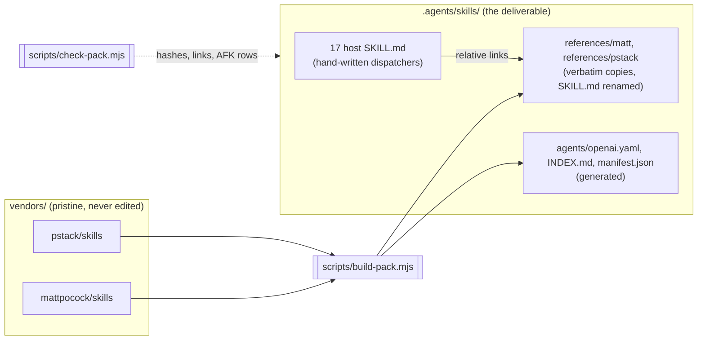
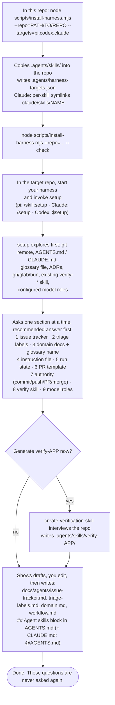
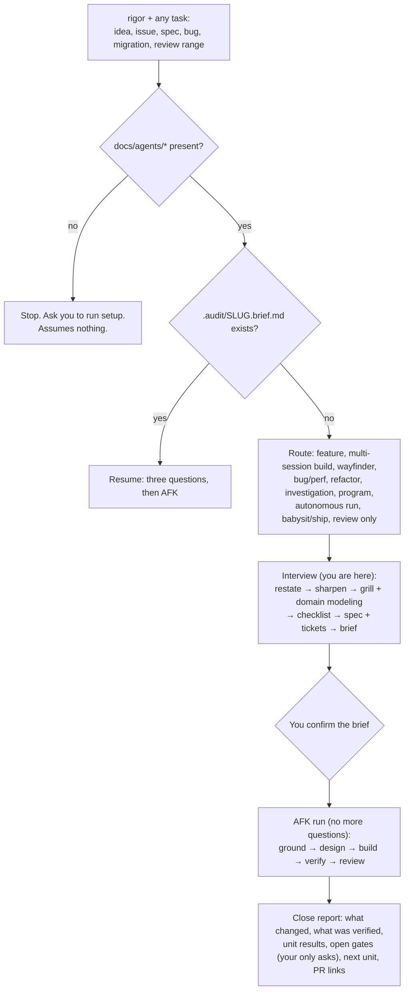
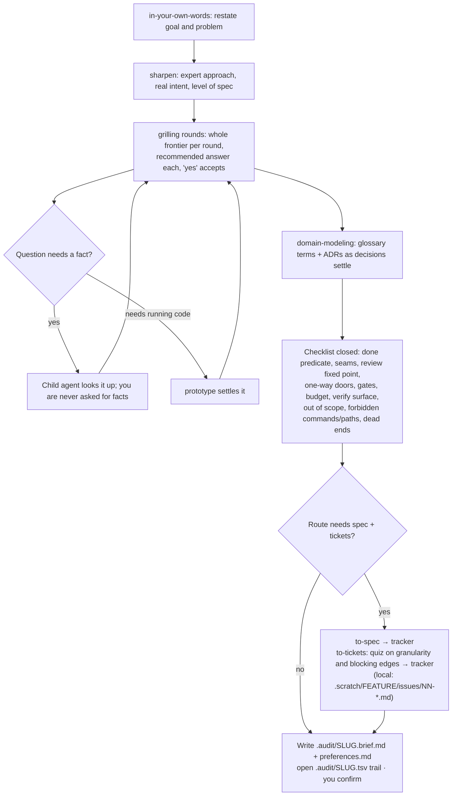
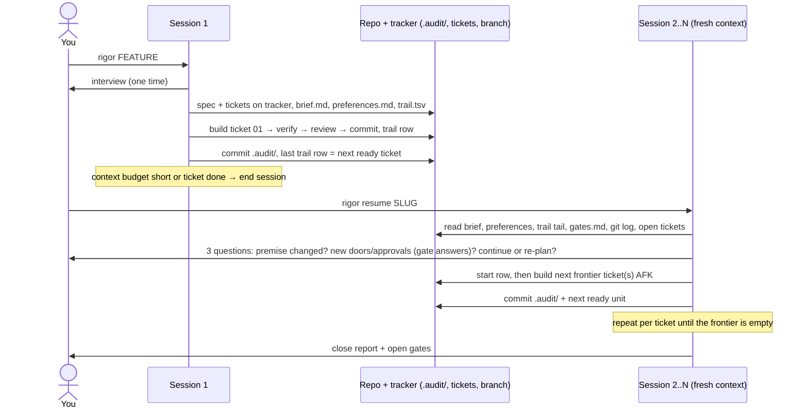

# skills-harness

One merged agent-skills pack built from two upstream collections, with one workflow. It installs into any repo and runs on **pi**, **OpenAI Codex CLI** and **Claude Code** from the same files.

- [mattpocock/skills](https://github.com/mattpocock/skills) (engineering lifecycle: grill → spec → tickets → implement → review → retro)
- [pstack](https://github.com/cursor/plugins/tree/main/pstack/skills) (playbooks, principles, adversarial review, decision trails, autonomy)

You need two names: run **`setup`** once per repo, then give every task to **`rigor`**. `rigor` interviews you once at the start. After that the run is AFK: it plans, builds, verifies and reviews without asking you anything, and parks anything irreversible as a gate for you to answer at the end.

## The pack: 17 skills

| Skill | Who invokes it | What it is for |
|---|---|---|
| `rigor` | you | The one workflow: route, interview, AFK run, resume, close |
| `setup` | you, once per repo | Every repo-level question, answered once into `docs/agents/` |
| `triage` | you | Move incoming issues through triage roles (human-present) |
| `handoff` | you | Hand off, pause, or pick up work |
| `retro` | you | Retro, reflect, correct, automate-me |
| `wait-what` | you | Re-pitch the last message, or catch up |
| `teach` | you | Explain code, or a multi-session learning workspace |
| `grilling` | model or you | Interview primitive (restate, sharpen, grill, questionnaire) |
| `domain-modeling` | model or you | Glossary, ADRs, model-the-domain |
| `codebase-design` | model or you | Deep modules, architect, arena, 11 design principles, TypeScript |
| `tdd` | model or you | Red-green at agreed seams; bug regression tests |
| `diagnosing-bugs` | model or you | Diagnosis loop, bug/perf/hillclimb/forensics playbooks |
| `code-review` | model or you | Standards + spec, interrogate, blast radius, comments, bot triage |
| `verify` | model or you | Prove it works; create/maintain `verify-<app>`; formal verification; benchmark checklist |
| `research` | model or you | Research, how, why, recall |
| `prototype` | model or you | Throwaway code that answers one design question |
| `writing` | model or you | Writing for agents, PR bodies, technical writing, unslop |

Each host `SKILL.md` is a short hand-written dispatcher. The upstream bodies it uses are copied verbatim under `references/matt/` and `references/pstack/`, and the dispatcher links to them by relative path. All 83 upstream skills are accounted for (81 copied, `make-bot-ui` dropped, and a one-line alias resolved into the skill it names); see [CHANGES.md](CHANGES.md).



## 1. First-time setup



## 2. Giving it a task



## 3. Planning (the interview)



## 4. Implementing (the AFK run)

```mermaid
flowchart TD
  G["ground: how over the area; merit + premise check<br/>gate: trail row"] --> D["design: codebase-design, architect/arena for one-way doors<br/>gate: every door crossed is pre-approved in the brief"]
  D --> U["next ready unit (ticket frontier / playbook step)"]
  U --> B["build: tdd at the brief's seams (one child per unit,<br/>own worktree if allowed)<br/>gate: commit + check command exits 0 + trail row"]
  B --> V["verify: verify-APP on the real surface<br/>gate: evidence exists at the logged path"]
  V -- no evidence --> B
  V -- no startable app --> UV["unit = unverified, run continues"]
  V --> RV["review: standards + spec, interrogate, blast radius, no-comments<br/>gate: blocking findings = 0 or round limit"]
  RV -- findings --> FX["fresh child fixes with consolidated scope"] --> RV
  RV --> RU["unit = verified, trail row"]
  UV --> MORE
  RU --> MORE{"more units?"}
  MORE -- yes --> U
  MORE -- no --> C["close: re-check done predicate on the real artifact<br/>PR body (recorded template) + unslop · ketchup-style report"]
  X["Irreversible step not pre-approved"] -. park in gates.md, route around .-> U
```

Mid-run rules ([rigor/AFK.md](.agents/skills/rigor/AFK.md)): a reversible ambiguity gets the conservative choice and a logged reason. An unapproved irreversible step becomes a gate. A missing harness feature gets the documented fallback, logged as `degraded: ...`. Unit results are only `verified`, `unverified`, `blocked`, `reverted` or `skipped`.

## 5. Implementing across separate sessions



Planning and building share a session by default (Continue is the first branch to rule out). Start a fresh session per ticket for multi-session builds, when the context budget is short, or for a wayfinder effort. State never lives in chat: a fresh session in any clone reaches full working state from `.audit/`, the tracker and git. To move to another harness or a colleague mid-phase, use `handoff`.

## Per-harness differences

The skill bodies, references, playbooks and scripts are byte-identical on every harness. Only these differ:

| | pi | Claude Code | Codex CLI |
|---|---|---|---|
| Finds `.agents/skills/` | natively | no: needs `.claude/skills/<name>` symlinks (installer) | natively |
| Invoke | `/skill:rigor` | `/rigor` | `$rigor` |
| Hidden-skill flag | frontmatter | frontmatter | generated `agents/openai.yaml` |
| Reads | `AGENTS.md`, `CLAUDE.md` | `CLAUDE.md` (which imports `@AGENTS.md`) | `AGENTS.md` |
| Subagents | pi-subagents extension | Agent tool | built in |
| Notes | [rigor/harness/pi.md](.agents/skills/rigor/harness/pi.md) | [rigor/harness/claude.md](.agents/skills/rigor/harness/claude.md) | [rigor/harness/codex.md](.agents/skills/rigor/harness/codex.md) |

Checked on 2026-10-20 from a fresh repo: each harness lists exactly the 10 advertised pack skills and none of the 7 hidden ones. `rigor` opens by explicit invocation on all three (pi 1.3.0, codex-cli 0.163.0, Claude Code), and with no setup it stops and asks for `setup`. Claude Code also ships a built-in `/code-review` that may shadow this pack's; `rigor` reaches `code-review` by path, so the workflow does not depend on the name.

## Layout

```
skills-harness/
├── README.md, CHANGES.md        ← this file; per-skill provenance
├── scripts/
│   ├── pack-layout.mjs          ← which vendor skill goes in which host (the plan)
│   ├── lib/pack.mjs             ← copy plan, relink transform, frontmatter reader, hashing
│   ├── build-pack.mjs           ← vendors/ → .agents/skills/ copies + generated files
│   ├── check-pack.mjs           ← validates the pack (also on an installed copy, --repo=)
│   └── install-harness.mjs      ← installs into a repo; per-harness footprint; --check
├── vendors/                     ← pristine upstream, never edited
├── .agents/skills/              ← the deliverable
│   ├── manifest.json            ← skills, every copied file with vendor/pre/post sha256
│   ├── rigor/  SKILL.md INTERVIEW.md AFK.md harness/ references/{INDEX.md,matt,pstack}
│   ├── setup/  SKILL.md templates/workflow.md references/...
│   └── <host>/ SKILL.md agents/openai.yaml references/{matt,pstack}/<name>/<name>.md
├── .agents/harness-targets.json ← targets this checkout installs for
└── .claude/skills/<name>        ← symlinks for Claude Code
```

## Build, check, install

```bash
node scripts/build-pack.mjs        # regenerate copies from vendors/; a second run is a zero diff
node scripts/check-pack.mjs        # must pass before any commit
node scripts/install-harness.mjs --repo=../my-app --targets=pi,codex,claude
node scripts/install-harness.mjs --repo=../my-app --check
```

`check-pack` fails on any of these:

- a broken link
- a deleted or extra skill (counted against the manifest)
- an edited copy
- a vendor file that changed since the build
- an interactive "ask the user" line in AFK scope with no row in `rigor/AFK.md`
- an `openai.yaml` flag that disagrees with the frontmatter
- a nested `SKILL.md`
- a reference to something outside the pack
- a skill list over Codex's 8,000-character default
- a missing Claude symlink for a declared target

To change behaviour, edit a host's `SKILL.md`, `rigor/*.md` or `setup/templates/`. Never edit a copy under `references/matt/` or `references/pstack/`: the build overwrites it and the check flags it.

## Upgrading upstream

```bash
git clone --depth 1 https://github.com/mattpocock/skills /tmp/mp-fresh
diff -r /tmp/mp-fresh/skills/engineering vendors/mattpocock/skills/engineering
# copy the same subset into vendors/, update the pin in scripts/pack-layout.mjs, then:
node scripts/build-pack.mjs && node scripts/check-pack.mjs
# check-pack names every new interactive line that needs an AFK.md row,
# and build-pack fails on any new vendor skill with no host.
```

## Vendor contents

| Vendor | Kept | Ref |
|---|---|---|
| mattpocock/skills | `skills/engineering/` (20), `skills/productivity/` (7), bucket READMEs, `LICENSE` | `49dd158` (v1.3.1), 2026-10-09 |
| cursor/plugins pstack | `skills/` (56), `LICENSE` | `d457567` (v0.15.28), 2026-10-19 |
